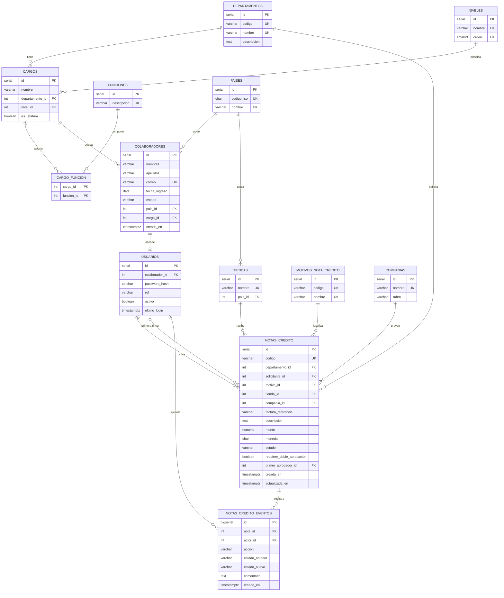

# Decisiones técnicas

## 1. Stack elegido y justificación

## 2. Modelo de datos

### Decisiones de modelado

- **Sin `departamento_id` en `colaboradores`:** el departamento se obtiene a través del cargo. Guardarlo dos veces permitiría inconsistencias.
- **Cargo por departamento:** `UNIQUE(nombre, departamento_id)` permite que dos departamentos tengan un cargo con el mismo nombre.
- **Funciones N:M:** una función puede pertenecer a varios cargos sin repetir su texto.
- **`usuarios` separada de `colaboradores`:** no todo colaborador tiene acceso; aísla las credenciales de los datos de RR. HH.
- **Rol con `CHECK`:** los roles están acoplados al código de autorización, y agregar uno exige cambiar el código de todos modos.
- **`NUMERIC(14,2)` para montos:** el punto flotante binario produce errores de redondeo en dinero.
- **`requiere_doble_aprobacion` guardado:** un cambio posterior del umbral no altera las notas en curso.
- **Auditoría de solo inserción:** no hay endpoints de edición, y un trigger de PostgreSQL rechaza `UPDATE` y `DELETE` en `notas_credito_eventos`.

### Datos entregados por la empresa

- **Tablas agregadas:** `tiendas` y `companias` vienen del dataset, lo que da 13 tablas. `tiendas` referencia `paises` en lugar de repetir el nombre del país.
- **Departamentos:** se agregan Cuentas por Cobrar y Cuentas por Pagar a los 4 departamentos iniciales.
- **Motivos:** el texto libre del dataset se normaliza en un catálogo de 7 motivos.
- **Monedas:** USD y VES se validan con `CHECK`, y `moneda` no tiene valor por defecto para no asumir una por omisión.
- **Umbral por moneda:** `NC_UMBRAL_USD` y `NC_UMBRAL_VES` evitan comparar monedas distintas o inventar una tasa de cambio.
- **Trazabilidad por usuario:** el README del dataset no exige registrar quién actúa, pero el enunciado pide auditar quién actuó e impedir la autoaprobación. Prevalece el enunciado.

## 3. Proceso de negocio elegido

## 4. Resolución de la ambigüedad de roles

## 5. Matriz de permisos y su aplicación

## 6. Decisiones de seguridad

## 7. Limitaciones conocidas

## 8. Qué haría con más tiempo
