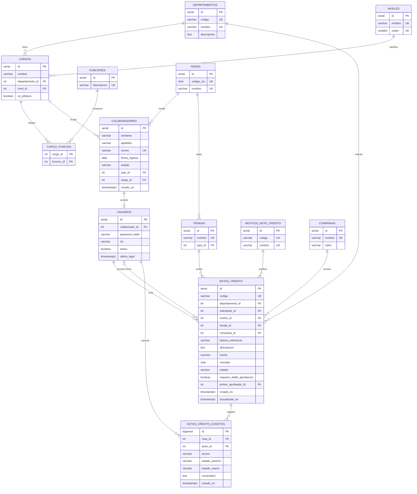

# Decisiones técnicas

## 1. Stack elegido y justificación

- **Backend: FastAPI, SQLAlchemy 2, Alembic y Pydantic.** Validación declarativa, documentación en `/docs` y migraciones versionadas.
- **Base de datos: PostgreSQL 16.** Es relacional real y ofrece `NUMERIC`, `TIMESTAMPTZ`, `CHECK` y `SELECT ... FOR UPDATE`.
- **Frontend: React 18, Vite y TypeScript.** React es un framework exigido por la prueba con amplio ecosistema; TypeScript tipa las respuestas de la API y Vite permite un proxy simple en desarrollo.
- **React Router, TanStack Query y Tailwind CSS.** Resuelven rutas, caché y estados de carga, y estilos, sin escribir esa infraestructura a mano.
- **Autenticación: JWT en cookie `httpOnly`.** El token no es accesible desde JavaScript.

## 2. Modelo de datos

### Decisiones de modelado

- **Sin `departamento_id` en `colaboradores`:** el departamento se obtiene a través del cargo. Guardarlo dos veces permitiría inconsistencias.
- **Cargo por departamento:** `UNIQUE(nombre, departamento_id)` permite que dos departamentos tengan un cargo con el mismo nombre.
- **Funciones N:M:** una función puede pertenecer a varios cargos sin repetir su texto.
- **`usuarios` separada de `colaboradores`:** no todo colaborador tiene acceso; aísla las credenciales de los datos de RR. HH.
- **Rol con `CHECK`:** los roles están acoplados al código de autorización, y agregar uno exige cambiar el código de todos modos.
- **`NUMERIC(14,2)` para montos:** el punto flotante binario produce errores de redondeo en dinero.
- **`requiere_doble_aprobacion` guardado:** un cambio posterior del umbral no altera las notas en curso.
- **Auditoría de solo inserción:** no hay endpoints de edición, y un trigger de PostgreSQL rechaza `UPDATE` y `DELETE` en `notas_credito_eventos`.

### Datos entregados por la empresa

- **Tablas agregadas:** `tiendas` y `companias` vienen del dataset, lo que da 13 tablas. `tiendas` referencia `paises` en lugar de repetir el nombre del país.
- **Departamentos:** se agregan Cuentas por Cobrar y Cuentas por Pagar a los 4 departamentos iniciales.
- **Motivos:** el texto libre del dataset se normaliza en un catálogo de 7 motivos.
- **Monedas:** USD y VES se validan con `CHECK`, y `moneda` no tiene valor por defecto para no asumir una por omisión.
- **Umbral por moneda:** `NC_UMBRAL_USD` y `NC_UMBRAL_VES` evitan comparar monedas distintas o inventar una tasa de cambio.
- **Trazabilidad por usuario:** el README del dataset no exige registrar quién actúa, pero el enunciado pide auditar quién actuó e impedir la autoaprobación. Prevalece el enunciado.

## 3. Proceso de negocio elegido

Se eligió el flujo de aprobación de notas de crédito (Opción 2) porque encaja con el modelo organizacional y ejercita separación de funciones, alcance por rol y auditoría.

- **Máquina de estados:** `TRANSICIONES` en `services/notas_credito.py` define qué acciones admite cada estado.
- **Separación de funciones:** nadie firma lo que solicitó, ni siquiera ADMIN, y la segunda firma debe ser de otra persona.
- **Doble aprobación:** un monto mayor al umbral de su moneda exige dos firmas. La regla se guarda en la nota y se recalcula al reenviarla.
- **Concurrencia:** cada transición bloquea la fila con `SELECT ... FOR UPDATE`, así que dos aprobadores simultáneos no pueden actuar sobre el mismo estado.
- **Auditoría transaccional:** el estado y su evento se confirman juntos; si algo falla, no queda ninguno.
- **Códigos de error:** 404 fuera de alcance, 403 rol no permitido o autoaprobación, 409 transición inválida y 422 validación.
- **Datos de demo:** las 25 notas del dataset se reproducen mediante el servicio. Se conservan montos, fechas y comentarios; las referencias de factura, descripciones, usuarios y segundas firmas son adaptaciones necesarias para este modelo. Se agregan 3 notas, identificadas como adicionales, para mostrar estados que el dataset no incluye.

## 4. Resolución de la ambigüedad de roles

El Colaborador es de solo lectura y el aprobador debe tener un rol distinto al del solicitante. Por eso se agrega el rol APROBADOR, asignado en Contraloría. ADMIN también puede aprobar, pero nunca sus propias solicitudes.

## 5. Matriz de permisos y su aplicación

- **`get_current_user`:** lee la cookie, valida el token y carga el usuario desde la BD en cada petición. El rol nunca se toma del token.
- **`require_roles`:** protege cada endpoint según el rol, y responde 403 si el rol no está permitido.
- **`aplicar_alcance_departamento`:** agrega el `WHERE` por departamento a la consulta SQL. ADMIN y APROBADOR tienen alcance global.
- **404 fuera de alcance:** un recurso de otro departamento responde igual que uno inexistente, para no revelar que existe.
- **Vista limitada:** el Colaborador recibe `ColaboradorPublico`, sin fecha de ingreso, país ni estado. Los campos no se ocultan en el frontend: la API no los envía.
- **Inactivos en la vista limitada:** el Colaborador solo ve compañeros activos y no puede filtrar por estado, porque eso revelaría un dato que su vista excluye.
- **Fichas del Colaborador:** solo puede abrir su propia ficha y su propio cargo.

## 6. Decisiones de seguridad

- **Contraseñas:** bcrypt con costo 12; nunca se guardan ni se devuelven en claro.
- **Sesión:** JWT HS256 de 60 minutos en una cookie `httpOnly`, `SameSite=Lax` y `Secure` configurable. El algoritmo está fijado al verificar.
- **Login:** mismo mensaje para usuario inexistente, contraseña errónea o cuenta inactiva. bcrypt también se ejecuta si el usuario no existe, para reducir diferencias de tiempo.
- **Desactivación:** la cuenta se comprueba en cada petición, así que el acceso se pierde de inmediato.
- **Errores internos:** el cliente recibe un mensaje genérico; el detalle queda en el log del servidor.

## 7. Limitaciones conocidas

- **Cierre de sesión:** borra la cookie, pero un token copiado antes sigue siendo válido hasta expirar, porque no hay lista de revocación.
- **Sin refresh tokens:** la sesión termina a los 60 minutos.
- **Sin rate limiting:** el login no limita los intentos.
- **Sin token CSRF dedicado:** la mitigación es `SameSite=Lax`, API solo JSON y CORS restringido.
- **Sin paginación, despliegue ni recuperación de contraseña:** el alcance es una demo local con datos ficticios.
- **El seed usa `TRUNCATE`:** el trigger de auditoría solo cubre `UPDATE` y `DELETE`.
- **El frontend no valida permisos:** oculta acciones para mejorar la experiencia, pero la autorización real está en el backend.

## 8. Qué haría con más tiempo

- Rate limiting en el login, refresh tokens y revocación de sesiones.
- Permisos en tablas en lugar de `CHECK` y código.
- Paginación, notificaciones y reportes del módulo de notas.
- CI con tests, despliegue con HTTPS y tests del frontend.
- Excepciones de negocio propias en lugar de `HTTPException` en el servicio.
